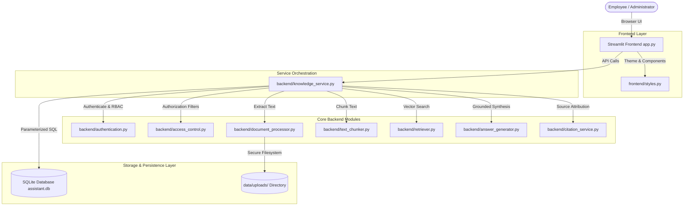
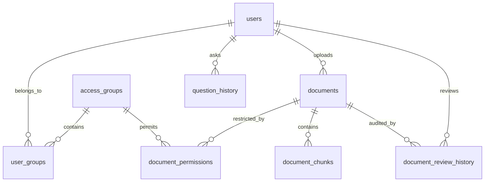
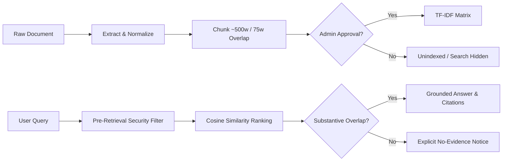

# Project Overview: Internal Company Knowledge Assistant

**Academic Level:** M.Sc. Information Technology Capstone / Final Project  
**Author:** AI Pair-Programming Assistant & Student Developer  
**Operating Environment:** Windows 10/11 Local Installation  

---

## 1. Executive Summary & Problem Definition

In contemporary enterprise and organizational settings, internal operational intelligence is distributed across numerous disparate documents: Standard Operating Procedures (SOPs), Frequently Asked Questions (FAQs), service descriptions, pricing matrices, and corporate compliance policies. Employees frequently spend significant working hours manually locating, reading, and interpreting lengthy policy files.

While generative artificial intelligence and large language models (LLMs) have gained popularity, deploying commercial cloud-based conversational agents introduces three critical challenges:
1. **Hallucination & Fabrication:** Commercial models often extrapolate or guess policy terms, discounts, and legal obligations when information is missing.
2. **Data Privacy & Compliance Risks:** Transmitting confidential internal documentation (e.g., board minutes, executive compensation, proprietary rate cards) to third-party cloud APIs violates data sovereignty and security regulations.
3. **Operational Cost & Latency:** Cloud API dependencies incur continuous token billing, vulnerability to rate limits, and external service outages.

The **Internal Company Knowledge Assistant** addresses these issues through a 100% local, self-contained, and deterministic retrieval-augmented architecture. It operates directly within an organization's secure network boundary, enforces strict Role-Based Access Control (RBAC), grounds all answers exclusively in approved documentation, provides verifiable page-level and section-level citations, and explicitly declines to guess when sufficient evidence is unavailable.

---

## 2. System Architecture & Components

The application is structured into decoupled modules following clean architectural principles:

### Module Responsibilities:
- **`app.py`:** Main user interface, role-aware navigation routing, session management, and visual presentation.
- **`backend/database.py`:** SQLite schema lifecycle, connection pooling with foreign key enforcement (`PRAGMA foreign_keys = ON;`), and transactional consistency.
- **`backend/authentication.py`:** User credential management, secure hashing via `bcrypt` (with PBKDF2 fallback), and session tokens.
- **`backend/access_control.py`:** Fine-grained authorization logic ensuring ordinary employees never retrieve, preview, or cite restricted or confidential records.
- **`backend/document_processor.py`:** Multi-format document parser handling PDF (PyMuPDF), DOCX (python-docx), and TXT with SHA-256 duplicate checking and scanned PDF detection.
- **`backend/text_chunker.py`:** Context-preserving text chunker with ~500 word windows, ~75 word overlap, and heading/page tracking.
- **`backend/retriever.py`:** Scikit-learn TF-IDF Vectorizer with unigram/bigram features and cosine similarity ranking.
- **`backend/answer_generator.py`:** Deterministic evidence synthesizer with substantive keyword overlap verification and explicit no-answer reporting.
- **`backend/citation_service.py`:** Pinpoint source attribution engine extracting exact supporting quotes and metadata.

---

## 3. Database Architecture & Schema

The relational schema is managed in SQLite with enforced relational constraints:

### Key Database Tables:
1. **`users`:** Stores user identifiers, unique usernames, bcrypt password hashes, full names, assigned roles (`Administrator`, `Employee`, `Reviewer`), and account status (`Active`, `Disabled`).
2. **`access_groups`:** Departmental and organizational access tiers (`All Employees`, `Human Resources`, `Engineering & IT`, `Finance & Accounting`, `Executive Leadership`).
3. **`user_groups`:** Many-to-many mapping linking user accounts to authorized access groups.
4. **`document_categories`:** Standardized classifications (`SOP`, `FAQ`, `Service Descriptions`, `Pricing Rules`, `Project Documentation`, `Policies and Guidelines`, `General Reference`).
5. **`documents`:** Master records containing original filenames, safe internal storage paths, SHA-256 hashes, file sizes, approval status (`Pending Approval`, `Approved`, `Rejected`, `Revoked`), classification (`Public`, `Restricted`, `Confidential`), and audit timestamps.
6. **`document_permissions`:** Explicit access grants linking restricted/confidential documents to authorized access groups.
7. **`document_chunks`:** Searchable text blocks with sequential chunk indices, word counts, physical page numbers (for PDFs), and section headings.
8. **`question_history`:** Isolated user Q&A log storing queries, synthesized responses, and JSON citation payloads.
9. **`document_review_history`:** Immutable audit log recording transitions (Submitted, Approved, Rejected, Revoked) along with reviewer IDs and review notes.

---

## 4. Information Retrieval Pipeline

1. **Extraction & Validation:** The document processor checks extension validity, file size (< 25 MB), and computes a cryptographic SHA-256 content hash. Scanned PDFs with 0 extractable characters are caught with a clear prompt regarding OCR limitations.
2. **Chunking with Metadata:** Extracted sections are divided into ~500 word chunks with ~75 word overlap. Crucially, heading titles and PDF physical page numbers are bound to every chunk tuple.
3. **Approval Gating:** Newly uploaded files start in `Pending Approval`. Unapproved documents are completely barred from the search index.
4. **Pre-Retrieval Access Control:** Before vector comparison, the user's role and group permissions generate a set of authorized document IDs. Only authorized chunks enter the scoring space.
5. **Evidence Sufficiency Verification:** Rather than trusting raw cosine scores (which can be skewed by single incidental words like "office"), the system computes substantive query-token coverage. If key concepts are unrepresented in the retrieved text, the system explicitly reports that no answer was found.
6. **Attribution & Citation:** Citations are generated from verified excerpts, displaying the document title, category, page number, section name, and exact quotation.
